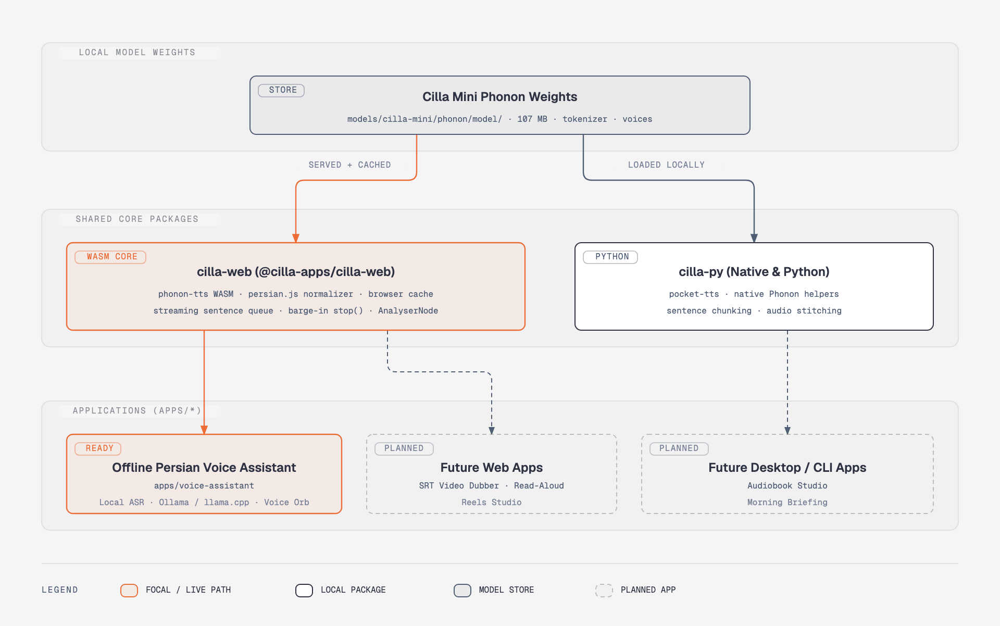

# Cilla Apps

A monorepo of local-first, privacy-preserving Persian voice applications built with **[Cilla Mini](https://huggingface.co/mehdi-hf/cilla-mini)** (18.2M parameters, 24 kHz Persian TTS running on CPU, Apple Silicon, and directly inside a browser tab via WebAssembly).

---

## System Architecture

Every app in this repository builds on top of a **shared Cilla / Phonon TTS core** so Persian text normalization, sentence chunking, streaming audio playback, and model caching are written once and reused everywhere:



<sub>Source: <a href="./docs/cilla-apps-architecture.html"><code>docs/cilla-apps-architecture.html</code></a></sub>

### Why a shared Phonon component?
- **Download once, reuse across apps:** When web apps are served under the same origin, the browser caches the 107 MB Cilla Mini weights once (`phonon-tts-v1`) and every app loads instantly.
- **Consistent Persian quality:** All apps share the same official `persian.js` normalization, digit-to-words conversion, sentence-by-sentence chunking, and chunk-level silence trimming (`cleanStart`).
- **Real-time voice UX out of the box:** `CillaBrowserTTS` streams 80 ms audio chunks (~20 ms to first audio), supports instant `stop()` for barge-in, and exposes live output frequency data (`getOutputLevel` / `getOutputFrequencyData`) for audio-reactive UIs.

---

## Apps

| App | Runtime | Status | Description |
| --- | --- | --- | --- |
| [`voice-assistant`](./apps/voice-assistant) | Browser WASM (`phonon-tts`) + Local Python (`uv`) + Ollama / `llama.cpp` | Ready | 100% offline Persian voice assistant with live audio-reactive orb, local Persian ASR (Whisper / Nemotron / FarsiCTC), and barge-in. |

### Planned / Ideas
- In-browser `.srt` Persian video dubber
- Zero-server Persian "Read Aloud" browser extension
- Multi-voice Persian audiobook & podcast studio
- Kids' Persian dictation (*Emla*) coach
- OBS Persian TTS alert box for streamers

---

## Repository Structure

```text
cilla-apps/
├── apps/
│   └── voice-assistant/     # Offline Persian Voice Assistant (FastAPI + Vite TS)
├── packages/
│   ├── cilla-web/           # Shared Phonon WASM TTS engine + Persian front-end
│   └── cilla-py/            # Shared Python helpers (pocket-tts / native Phonon)
├── docs/
│   └── wasm-headers.md      # COOP/COEP headers for multi-threaded WASM
└── models/                  # Local model weights (gitignored)
```

---

## Quick Start

1. **Download Cilla Mini (`phonon/` files):**
   ```bash
   hf auth login
   hf download mehdi-hf/cilla-mini --include "phonon/*" --local-dir models/cilla-mini
   ```
2. **Install JS workspace dependencies:**
   ```bash
   pnpm install
   ```
3. **Run an app** — see each app's README (e.g. [`apps/voice-assistant/README.md`](./apps/voice-assistant/README.md)).

---

## Contributing

Contributions are very welcome! If you have an idea for a Persian voice app or want to add one:

1. Create a new folder under `apps/<your-app-name>/`
2. Import `@cilla-apps/cilla-web` (`CillaBrowserTTS`) for browser apps, or use `pocket-tts` / native `phonon` for Python/desktop apps
3. Add a short `README.md` inside your app folder and list it in the table above
4. Open a Pull Request!

---

## Model & Licensing

- **Model:** [`mehdi-hf/cilla-mini`](https://huggingface.co/mehdi-hf/cilla-mini) (gated HuggingFace repo; accept the terms on the model page before downloading weights).
- **Model License:** CC BY-NC 4.0 for non-commercial use. Commercial licenses are available at [oncillaai.com/pricing](https://oncillaai.com/pricing/).
- Model weights (`*.safetensors`) and generated audio files are gitignored and downloaded locally when running each app.
