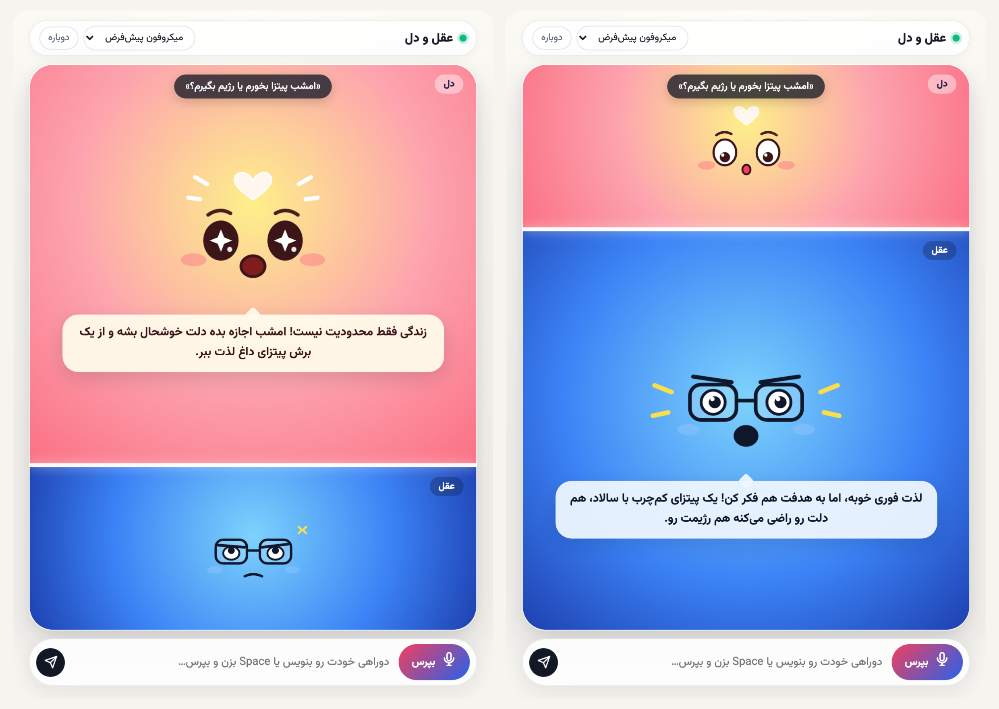

# عقل و دل (Head vs. Heart)

An offline, animated Persian two-character voice debate app powered by **[Cilla Mini](https://huggingface.co/mehdi-hf/cilla-mini)** (`@cilla-apps/cilla-web`), inspired by [`pipecat-ai/ios-little-voices`](https://github.com/pipecat-ai/ios-little-voices).

Ask any real-life dilemma out loud or by text—**دل** (Heart, `parisa` voice) and **عقل** (Head, `voice2` male voice) debate it back and forth in Persian with dynamic split-screen animations, reactive facial expressions, and live audio-driven mouth lip-sync.



## How It Works

1. **You ask a dilemma** by voice (raw 16 kHz PCM16 over WebSocket → local Persian ASR) or text (or tap a starter chip).
2. **A 4-turn debate director** (`server/debate.py`) streams short alternating replies for **دل** and **عقل** from a local LLM (**Ollama** `aya-expanse:8b` or **`llama-server`**).
3. **Browser-side Cilla Mini TTS (`@cilla-apps/cilla-web`)** synthesizes each character's sentences in WebAssembly (`parisa` for **دل**, `voice2` for **عقل**), switching the active character spotlight, speech bubble, and real-time lip-sync the exact moment each voice starts speaking.
4. **Instant barge-in:** tap **توقف** or press `Space` anytime to interrupt their debate.

## Prerequisites

1. **Cilla Mini (`phonon/` files)** downloaded into `models/cilla-mini`:
   ```bash
   hf download mehdi-hf/cilla-mini --include "phonon/*" --local-dir models/cilla-mini
   ```
2. **Local Persian LLM** via Ollama (or `llama-server`):
   ```bash
   ollama pull aya-expanse:8b
   ```

## Run Locally

### 1. Start the Python backend (`uv`)
```bash
cd apps/aghl-o-del/server

# With public Whisper ASR (recommended for public clones):
uv sync --extra whisper
ASR_BACKEND=whisper uv run --extra whisper python app.py

# Or with the default local FarsiCTC ASR:
# uv sync && uv run python app.py
```

*(For even stronger open-source Persian ASR, see [`mallahyari/nemotron-asr-streaming-farsi`](https://github.com/mallahyari/nemotron-asr-streaming-farsi).)*

### 2. Start the Web UI (`pnpm`)
From the repo root:
```bash
pnpm install
pnpm --filter @cilla-apps/aghl-o-del-web dev
```

Open **http://localhost:5174** in your browser.

## Using `llama.cpp` (`llama-server`)

```bash
LLM_BASE_URL=http://localhost:8080/v1 LLM_MODEL=<your-model> ASR_BACKEND=whisper uv run --extra whisper python app.py
```

## Configuration

| Variable | Default | Description |
| --- | --- | --- |
| `ASR_BACKEND` | `embeddinggemma2-ctc` | `whisper` (public, requires `--extra whisper`) or `embeddinggemma2-ctc` |
| `ASR_MODEL` | `mehdi-hf/embeddinggemma2-asr-ctc-farsi-v1` (or `whisper-large-v3-turbo`) | ASR model repo / name |
| `LLM_BASE_URL` | `http://localhost:11434/v1` | Ollama or `llama-server` OpenAI-compatible endpoint |
| `LLM_MODEL` | `aya-expanse:8b` | Local Persian LLM |
| `PORT` | `8788` | Backend port |
