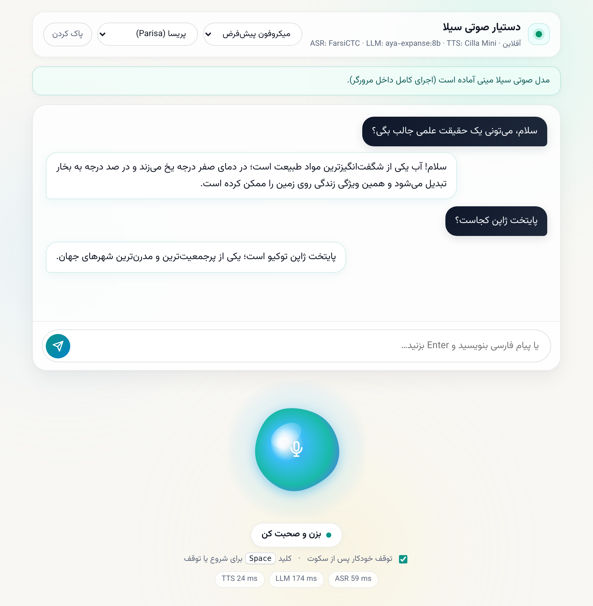

# Offline Persian Voice Assistant

A 100% offline, low-latency Persian voice assistant built with:

- **ASR (Speech-to-Text):** Pluggable local Persian ASR — see **ASR Options** below (supports Whisper out of the box, my open Persian streaming ASR [`nemotron-asr-streaming-farsi`](https://github.com/mallahyari/nemotron-asr-streaming-farsi), or the private `embeddinggemma2-asr-ctc-farsi-v1` research model)
- **LLM (Brain):** **Ollama** (`aya-expanse:8b`, 5.1 GB, Cohere multilingual with first-class Persian) by default — or **`llama.cpp` (`llama-server`)** via one env var
- **TTS (Voice):** **[Cilla Mini](https://huggingface.co/mehdi-hf/cilla-mini)** (18.2M, 107 MB) streaming inside the browser via `phonon-tts` WebAssembly (~20 ms to first audio)



## ASR Options

> **Note:** The default `mehdi-hf/embeddinggemma2-asr-ctc-farsi-v1` repo is currently **private**. If you are cloning this project publicly, use either of the open alternatives below:

### Option A — Whisper (`whisper-large-v3-turbo`, built-in)
Works out of the box with `mlx-whisper` on Apple Silicon or `faster-whisper` on CPU/CUDA:

```bash
cd apps/voice-assistant/server
uv sync --extra whisper
ASR_BACKEND=whisper uv run --extra whisper python app.py
```

You can pick any Whisper checkpoint via `ASR_MODEL` (e.g. `ASR_MODEL=mlx-community/whisper-large-v3-turbo` on Mac or `ASR_MODEL=large-v3-turbo` on CPU/CUDA).

### Option B — Nemotron Streaming Persian ASR (open-source, recommended for Persian!)
For much stronger Persian accuracy (8.8% FLEURS fa WER, ~10× real-time on Apple Silicon, native streaming), check out my public Persian ASR model and code:

- **GitHub:** [mallahyari/nemotron-asr-streaming-farsi](https://github.com/mallahyari/nemotron-asr-streaming-farsi)
- **HuggingFace:** [`mehdi-hf/nemotron-asr-streaming-farsi`](https://huggingface.co/mehdi-hf/nemotron-asr-streaming-farsi)

It runs via 🤗 Transformers on Apple Silicon (MPS), CUDA, or CPU (set the language prompt to `fa-IR`) and can be dropped straight into `apps/voice-assistant/server/asr.py`.

## Prerequisites

1. **Download Cilla Mini (`phonon/` files)** into `models/cilla-mini`:
   ```bash
   hf download mehdi-hf/cilla-mini --include "phonon/*" --local-dir models/cilla-mini
   ```
2. **Pull a Persian-capable local LLM** in Ollama:
   ```bash
   ollama pull aya-expanse:8b
   ```
   *(Or use `llama.cpp` instead of Ollama — see below.)*
3. **`ffmpeg`** installed (`brew install ffmpeg` on macOS).

## Run Locally

### 1. Start the Python backend (`uv`)
```bash
cd apps/voice-assistant/server
uv sync
uv run python app.py
```

### 2. Start the Web UI (`pnpm`)
In a second terminal from the repo root:
```bash
pnpm install
pnpm --filter @cilla-apps/voice-assistant-web dev
```

Open **http://localhost:5173** in Chrome/Edge/Safari, click **بارگذاری مدل صوتی** (cached in your browser after the first load), and tap the orb or press **Space** to talk!

## Using `llama.cpp` (`llama-server`) instead of Ollama

The server speaks the standard OpenAI-compatible `/v1/chat/completions` streaming API, so you can swap in `llama.cpp` with zero code changes:

```bash
# Terminal 1: start llama-server with a small GGUF model
llama-server -hf ggml-org/gemma-3-1b-it-GGUF:Q4_K_M --port 8080

# Terminal 2: point the backend at llama-server
cd apps/voice-assistant/server
LLM_BASE_URL=http://localhost:8080/v1 LLM_MODEL=gemma-3-1b-it uv run python app.py
```

## Configuration (Environment Variables)

| Variable | Default | Description |
| --- | --- | --- |
| `ASR_BACKEND` | `embeddinggemma2-ctc` | `whisper` (public, requires `--extra whisper`) or `embeddinggemma2-ctc` |
| `ASR_MODEL` | `mehdi-hf/embeddinggemma2-asr-ctc-farsi-v1` (or `whisper-large-v3-turbo`) | ASR model repo / name |
| `ASR_MODEL_DIR` | `models/embeddinggemma2-asr-ctc-farsi-v1` | Local path to `FarsiCTC` model |
| `ASR_DEVICE` | auto (`cuda` / `mps` / `cpu`) | Override `FarsiCTC` device |
| `LLM_BASE_URL` | `http://localhost:11434/v1` | Any OpenAI-compatible local server (Ollama, `llama-server`, LM Studio) |
| `LLM_MODEL` | `aya-expanse:8b` | Model name served by `LLM_BASE_URL` |
| `CILLA_MODEL_DIR` | `models/cilla-mini/phonon/model` | Path to Cilla Mini's Phonon model directory |
| `PORT` | `8787` | FastAPI backend port |
